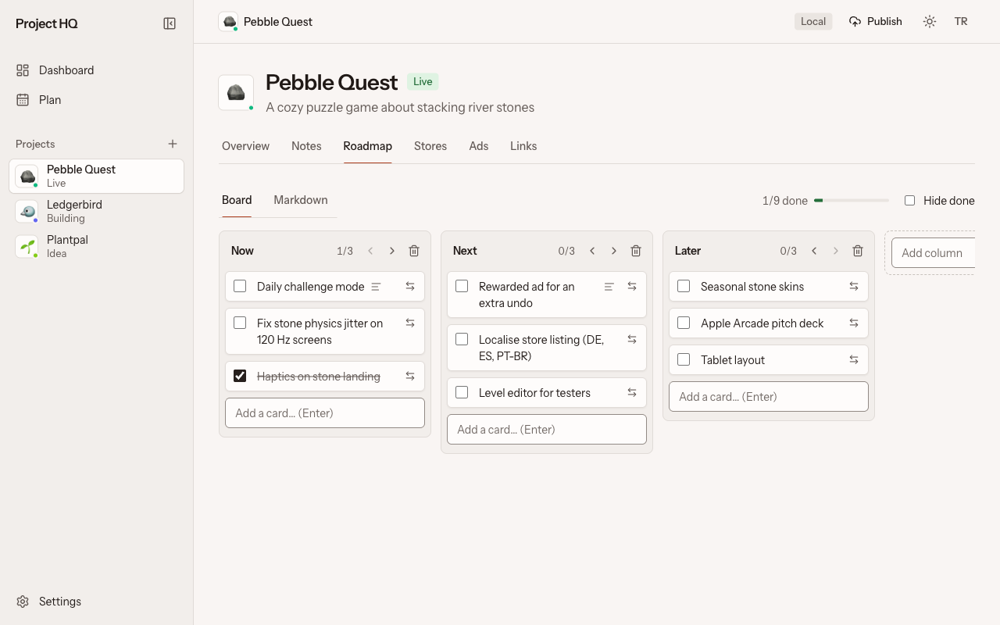
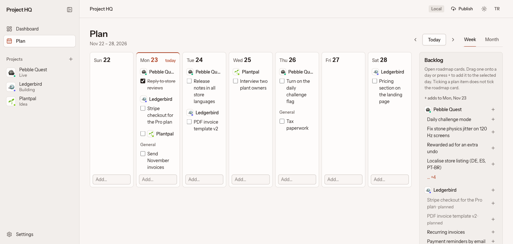
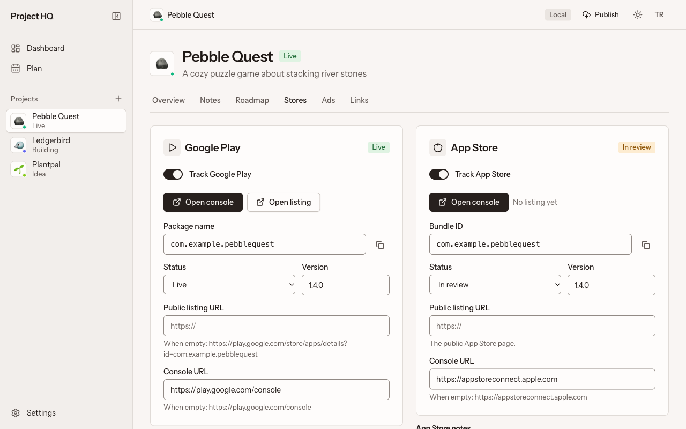
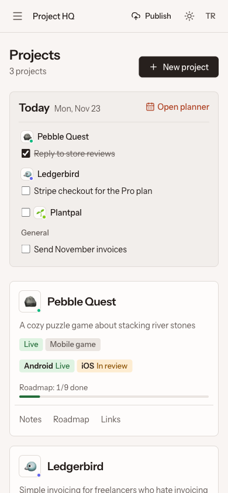

# Project HQ

[Türkçe](README.tr.md)

[](https://github.com/EngincanV/project-hq/actions/workflows/ci.yml)
[](LICENSE)

**Project HQ is a small, calm, local-first headquarters for people who build and ship many apps.** Keep notes, a roadmap
board, a cross-project planner, Google Play / App Store / AdMob details and quick links to every console for all your
apps, games and SaaS products in one place.

Everything you write is plain Markdown and JSON in **your own git repository**. A **Publish** button turns your edits
into a commit (and a push). Because the content is just files, you can also edit it with any editor, or let a coding
agent such as **[Claude Code](#using-project-hq-with-claude-code)** update it; the open app picks the changes up by itself.

**Who it is for:** indie developers and small teams who juggle several apps and are tired of keeping roadmaps in one
tool, store notes in another and console bookmarks in a third, and who want to own their data.


> **Status: early `0.1` release.** Expect rough edges. See [Limitations and known gaps](#limitations-and-known-gaps).

## Contents

- [Features](#features)
- [Screenshots](#screenshots)
- [How it works](#how-it-works)
- [Two ways to run it: desktop app or from source](#two-ways-to-run-it)
- [Desktop app (macOS and Windows)](#desktop-app-macos-and-windows)
- [Prerequisites](#prerequisites)
- [Quick start (from source, in the browser)](#quick-start-from-source-in-the-browser)
- [Configuration](#configuration)
- [Integrations: GitHub, Google Play, App Store, AdMob](#integrations)
- [Publishing: how commit and push work](#publishing-how-commit-and-push-work)
- [Using Project HQ with Claude Code](#using-project-hq-with-claude-code)
- [Using it on your phone (PWA)](#using-it-on-your-phone-pwa)
- [Content format](#content-format)
- [Keyboard shortcuts](#keyboard-shortcuts)
- [Security notes](#security-notes)
- [Development](#development)
- [Releasing (maintainers)](#releasing-maintainers)
- [Contributing](#contributing)
- [Limitations and known gaps](#limitations-and-known-gaps)
- [License](#license)

## Features

- **Projects.** One folder per project with a name, emoji, colour, type (mobile game, mobile app, web app, SaaS, other)
  and status (idea, building, live, paused, archived). The dashboard shows them as cards with roadmap progress and store status.
- **Notes.** As many Markdown notes per project as you like, with a real editor: Write / Split / Preview views, a
  formatting toolbar and shortcuts, task lists you can tick in the preview, tables, code blocks, links, and images you
  can paste, drop or pick (saved next to the notes in `assets/` and linked with a relative path). Autosave, no save button.
- **Roadmap.** A board per project. Columns and cards are just `##` headings and `- [ ]` items in `roadmap.md`; add,
  edit, move, tick, or switch to the raw Markdown.
- **Planner.** A week and month calendar across all projects. Plan a day, tag items with a project, drag open roadmap
  cards from the backlog onto a day. Today's plan is also on the dashboard.
- **Stores.** Google Play and App Store per project: package / bundle id, status, version, listing and console links,
  plus a Markdown page for listing text and release checklists.
- **Ads.** AdMob publisher and app ids, a dashboard link and a notes page for ad units and experiments.
- **Links.** Quick-launch cards for consoles and dashboards (Play Console, App Store Connect, AdMob, Firebase, Stripe,
  Vercel…), grouped as you like. They open in a new tab; nothing is embedded.
- **Publish.** See every unpublished change, write (or accept) a commit message, discard changes one by one, publish.
- **Live refresh.** In local mode the app notices changes made to the content folder by other tools (an editor, Claude
  Code, `git pull`) and refreshes within a few seconds.
- **Two modes.** Run it locally with Node and git, or deploy the same build as an installable PWA that talks to the
  GitHub API from your phone.
- English and Turkish UI, light and dark themes, works on a phone.

## Screenshots

| Notes editor (split view) | Roadmap |
| --- | --- |
|  |  |
| **Planner** | **Stores** |
|  |  |



<!-- Screenshot placeholders: add these when the screens are final.
| Publish panel | Settings (local mode, content folder) |
| --- | --- |
|  |  |
-->

All screenshots show the bundled, fictional demo content.

## How it works

```
             ┌──────────────── browser ─────────────────┐
             │  React app (src/)                        │
             │  features/* ── data/* ── storage adapter │
             └───────────────┬───────────────┬──────────┘
                 local mode  │               │  github (PWA) mode
                             ▼               ▼
         ┌──────────────────────────┐   ┌──────────────────────────┐
         │ Local API (server/)      │   │ api.github.com           │
         │ Node, 127.0.0.1 only     │   │ fine-grained token,      │
         │ files + git CLI          │   │ drafts in IndexedDB      │
         └────────────┬─────────────┘   └────────────┬─────────────┘
                      ▼                              ▼
         your content repo on disk          your content repo on GitHub
         (<HQ_ROOT>/content/…)              (<owner>/<repo>/<content dir>/…)
```

- **The app** (`src/`) is React + TypeScript with plain CSS modules. Every feature reads and writes files through one
  small storage interface (`src/storage/types.ts`), so it does not care where the files live.
- **Local mode** (`npm start` / `npm run dev`, or the desktop app): a zero-dependency Node server (`server/`) serves the app and a local API on
  `127.0.0.1`. The API reads and writes files in your content folder and runs your own `git` for Publish / Discard /
  Refresh. It also exposes a cheap fingerprint of the content folder that the app polls, which is how outside changes
  show up without a reload.
- **PWA / GitHub mode** (static hosting such as GitHub Pages): there is no server. The app talks to the GitHub REST API
  with a fine-grained token you enter in Settings. Edits are kept as drafts in the browser and Publish makes one commit.
- **Desktop app** (Electron): the same local mode in its own window. It starts the same server (`startServer()` in
  `server/server.mjs`) on a free `127.0.0.1` port and shows it; only where settings are stored differs.
- **The app picks its mode by itself**: if `./api/health` answers, it is local mode; otherwise GitHub mode.
- **Two repositories.** This repo (the app) never contains your data. Your content lives in its own, usually private,
  repository, so updating the app is a plain `git pull`.

More detail: [docs/ARCHITECTURE.md](docs/ARCHITECTURE.md).

## Two ways to run it

Both options are the same app from the same code, and both keep your content in your own git repository:

| | Desktop app | From source (browser) |
| --- | --- | --- |
| Install | download an installer from [Releases](https://github.com/EngincanV/project-hq/releases) | clone, `npm install`, `npm start` |
| Needs | git | Node.js, npm and git |
| Opens in | its own window | your browser at `http://127.0.0.1:4173` |
| Settings stored in | `settings.json` in the app's data folder | `.env.local` in the app folder |
| Updates | built in (see [Updates](#updates)) | `git pull` |

The PWA on a phone ([below](#using-it-on-your-phone-pwa)) is a third way, for GitHub mode.

## Desktop app (macOS and Windows)

### Download and install

Get the latest version from [GitHub Releases](https://github.com/EngincanV/project-hq/releases):

- **macOS:** `Project-HQ-<version>-mac-arm64.dmg` for Apple silicon (M1 and later) or `…-mac-x64.dmg` for Intel Macs.
  Open the dmg and drag **Project HQ** into **Applications**.
- **Windows:** `Project-HQ-Setup-<version>.exe`. It installs for your user only (no administrator rights needed) and adds
  a Start menu shortcut.

### First launch of an unsigned build

Release builds are not code-signed unless the maintainer has added signing certificates, so the operating system warns
the first time:

- **macOS** says the app "cannot be opened because the developer cannot be verified" (or that it is "damaged"). In
  Finder, **right-click** (or Control-click) **Project HQ** in Applications → **Open** → **Open**. If macOS still refuses,
  run this once in Terminal and open the app again:

  ```sh
  xattr -cr "/Applications/Project HQ.app"
  ```

- **Windows** shows "Windows protected your PC" (SmartScreen). Click **More info** → **Run anyway**.

You only need to do this once per installed version.

### git must be installed

The desktop app uses your own `git` for Publish, Discard and Refresh, exactly like `npm start`.

- macOS: run `xcode-select --install` or install git with [Homebrew](https://brew.sh) (`brew install git`).
- Windows: install [Git for Windows](https://git-scm.com/download/win).

Apps opened from Finder or the Start menu do not see your terminal's `PATH`. Project HQ fixes that at start-up: on macOS
it reads the `PATH` (and `SSH_AUTH_SOCK`) of your login shell and also looks in `/opt/homebrew/bin` and `/usr/local/bin`;
on Windows it looks in the standard Git for Windows and GitHub CLI folders. Your SSH agent, the macOS keychain, Git
Credential Manager and `gh` as a credential helper keep working.

To check, open **Settings → Local repository**, enter or choose a folder and press **Test connection**. It shows whether
git was found (and its version), whether the folder is a git repository, its branch and remote, and how many content
files it has. "Git was not found" means git is not installed or is somewhere unusual; install it as above and restart the app.

### Choose your content folder

The first launch shows the demo content. Open **Settings → Local repository**, click **Choose folder** and pick your
content repository (the folder that contains `content/`; create one with `npm run setup` from a clone, or use any git
repository; the content folder is created on the first write). **Test connection**, then **Save**: the app switches
folders right away, no restart needed.

### Where desktop settings are stored

| OS | Folder |
| --- | --- |
| macOS | `~/Library/Application Support/Project HQ/` |
| Windows | `%APPDATA%\Project HQ\` (e.g. `C:\Users\<you>\AppData\Roaming\Project HQ\`) |

`settings.json` holds the content folder (`root`, `contentDir`) and the last port used; `window-state.json` holds the
window size and position. The app never reads `.env.local` or environment variables, so a shell variable cannot point it
somewhere unexpected. Theme, language and GitHub-mode drafts live in the app's browser storage in the same folder.
Development runs (`npm run desktop:dev`) use `Project HQ (dev)` instead, so they never touch an installed copy.

### Open at login

**Settings → Desktop app → Open at login** starts Project HQ when you log in. The same section shows the installed version.

### Updates

The app checks GitHub Releases shortly after start and every six hours (only published releases, never drafts or pre-releases).

- **Windows** (and **signed** macOS builds): the update downloads in the background; a small notice offers **Restart**,
  otherwise it installs the next time you quit.
- **Unsigned macOS builds** cannot replace themselves (macOS only allows that for signed apps), so a small notice says a
  new version is available, with a **Download** link to its release page. Install it like the first time.

**Help → Check for Updates…** (on macOS: **Project HQ → Check for Updates…**) checks right away.

### Run and build from source

```sh
npm install
npm run desktop:dev      # Electron window on the Vite dev server, with hot reload
npm run desktop:build    # builds the web app, then the installer for this OS into release/
npm run desktop:smoke    # starts the main process with --smoke-test: checks /api/health and the preload, exits 0 or 1
```

`desktop:build` makes `release/Project-HQ-<version>-mac-arm64.dmg` and `…-mac-x64.dmg` (plus zips for updates) on macOS,
and `release/Project-HQ-Setup-<version>.exe` on Windows. Build each OS on that OS.

### One codebase

The desktop app is not a second app. `electron/main.mjs` calls the same `startServer()` as `npm start` and loads it in a
window; the React app, the local API, the content format and the security rules are shared. The only desktop-specific
parts are the Electron files in `electron/` (main process, preload, menu, PATH fix, updates, window state), the
`settings.json` branch of `server/config.mjs`, and a few UI pieces that appear only when `window.hq` exists (Choose folder,
Open at login, version, update notice). Without Electron, the web version behaves exactly as before.

## Prerequisites

For running from source (the desktop app needs only git):


- [Node.js](https://nodejs.org) 22.22+, 24.15+ or 26+ (`.nvmrc` pins 24) and npm.
- [git](https://git-scm.com), with `user.name` and `user.email` set (Publish makes commits).
- Optional: a GitHub account, to back your content up in a private repository and to use the PWA on a phone.
- Optional: [Claude Code](https://docs.claude.com/en/docs/claude-code/overview), see [below](#using-project-hq-with-claude-code).

## Quick start (from source, in the browser)

```sh
git clone https://github.com/EngincanV/project-hq.git   # or your fork
cd project-hq
npm install
npm start            # serves http://127.0.0.1:4173 with demo content
```

Look around: the demo projects are there so every screen has something to show. You can edit freely; demo edits go to a
temporary copy and are gone when you stop the server, and publishing is off.

When you want your own content:

```sh
npm run setup        # asks where your content repo should live, creates it and points the app at it
npm start            # restart: now you see your own (empty) workspace
```

`npm run setup` asks where to put the content repository (by default a sibling folder next to the app, e.g.
`../project-hq-content`; any path works), creates `<dir>/content/`, runs `git init -b main` there, optionally copies the
demo projects, optionally adds a GitHub remote, adds a `CLAUDE.md` for coding agents, and writes `HQ_ROOT=<dir>` to
`.env.local` (git-ignored). It never deletes anything, never creates a GitHub repo and never pushes. Re-run it any time to
switch to another folder. Non-interactive example:

```sh
npm run setup -- --dir ~/notes/hq --no-examples --remote git@github.com:<you>/<your-content-repo>.git --yes
```

`npm start -- --open` also opens the browser. `npm start` builds the app first when needed, so there is no separate build step.

## Configuration

Project HQ has no hard-coded user, repository, owner, app id or path. Everything that differs between users is either an
environment variable (server / build), a setting in the app, or a field in your own content.

### Environment variables

Copy [`.env.example`](.env.example) to `.env.local` (git-ignored) or export the variables in your shell. Precedence:
environment, then `.env.local`, then the default. None of these is a secret.

| Variable | Used by | Default | What it does |
| --- | --- | --- | --- |
| `HQ_ROOT` | local server | *(unset → demo mode)* | Folder of your content git repo. Relative to the app folder, or absolute. `npm run setup` writes it. |
| `HQ_CONTENT_DIR` | local server | `content` | Sub-folder of `HQ_ROOT` that holds `projects/` and `plan/`. Must be inside `HQ_ROOT`; `.` = the repo root. |
| `PORT` | `npm start` | `4173` | Port of the local server (always bound to `127.0.0.1`). `npm run dev` uses Vite's port (5173). |
| `HQ_WATCH_INTERVAL_MS` | local server → app | `3000` | How often the open app checks the content folder for outside changes. `0` turns it off. |
| `VITE_HQ_REPO` | PWA build | *(empty)* | `owner/repo` that **prefills** the GitHub Settings form. Baked into the public bundle; never put a token here. |
| `VITE_HQ_BRANCH` | PWA build | `main` | Branch that prefills the Settings form. |

In the GitHub Pages workflow the two `VITE_*` values come from the repository **variables** `HQ_CONTENT_REPO` and
`HQ_CONTENT_BRANCH` (*Settings → Secrets and variables → Actions → Variables*).

### `npm run setup` flags

| Flag | Default | What it does |
| --- | --- | --- |
| `--dir <path>` | asks; suggests `../project-hq-content` | Where the content repo lives. |
| `--here` | off | Keep content inside this app repo (`HQ_ROOT=.`), only for a **private** fork. |
| `--with-examples` / `--no-examples` | asks; no | Copy the demo projects as a starting point. |
| `--claude-md` / `--no-claude-md` | asks; yes | Add `CLAUDE.md` (content formats for coding agents) to the content repo. |
| `--remote <url>` | asks; none | Add this URL as `origin` of the content repo. |
| `-y`, `--yes` | off | Do not ask; use flags and defaults. |

### In-app settings

| Where | Setting | Stored in |
| --- | --- | --- |
| Settings → GitHub connection (PWA mode) | Repository (`owner/repo`), branch, content folder, access token | this browser's `localStorage` |
| Settings → Local repository (local mode) | Repository folder and content folder (with **Test connection**; **Choose folder** in the desktop app); shows the content folder path, GitHub remote and whether Publish works | `.env.local` (`HQ_ROOT`, `HQ_CONTENT_DIR`) from source; `settings.json` in the desktop app |
| Settings → Desktop app (desktop only) | Open at login; shows the version | the operating system's login items |
| Settings → Appearance | Theme (light / dark / system) | this browser |
| Top bar | Language (English / Türkçe) | this browser |
| Project → Overview | Name, tagline, type, status, emoji, colour, enabled tabs (Stores, Ads), code repositories, website | `projects/<slug>/project.json` |
| Project → Stores | Package name / bundle id, status, version, listing URL, console URL per store | `project.json` + `stores/*.md` |
| Project → Ads | AdMob publisher id, Android / iOS app ids, dashboard URL | `project.json` + `ads/admob.md` |
| Project → Links | Any console / dashboard links, with presets | `project.json` |

To use a different content folder in local mode, choose it in **Settings → Local repository** and press **Save** (the
switch is immediate), or run `npm run setup` again / edit `HQ_ROOT` in `.env.local` and restart the server. When `HQ_ROOT`
is set as an environment variable it wins, and the form says so instead of saving.

## Integrations

Be clear about what each integration does today: **GitHub is a real API integration** (it is the storage backend of the
PWA mode). **Google Play, App Store and AdMob are tracked, not synced**: you keep their ids, status, links and notes in
your content, and Project HQ builds the right URLs and console links. Project HQ never asks for Google or Apple
credentials and makes no calls to their APIs.

### GitHub

- **Local mode:** nothing to configure in the app. Create an **empty private repository** on github.com and add it as the
  remote of your content repo (or pass `--remote` to `npm run setup`):

  ```sh
  cd ../project-hq-content          # your HQ_ROOT
  git remote add origin https://github.com/<you>/<your-content-repo>.git
  ```

  Then press Publish; the first publish runs `git push -u origin main`. Authentication is your normal git setup
  (credential helper or SSH key). The app shows the remote in Settings and links each commit after publishing.
- **PWA mode:** create a fine-grained token, enter it in Settings. See [Using it on your phone](#using-it-on-your-phone-pwa).
- **Per-project code repositories:** in a project's Overview, add links to its code repositories (`repos` in
  `project.json`). They appear on the Overview, and the *GitHub* link preset points at the first one. This is also how
  you tell Claude Code which code belongs to which project (see below).

### Google Play

In a project's **Overview**, enable the *Stores* tab. In **Stores → Google Play**: turn it on, enter the **package name**
(e.g. `com.example.app`), pick the status (not started, draft, internal / closed / open testing, in review, live,
rejected) and the version. The public listing URL is built from the package name
(`https://play.google.com/store/apps/details?id=…`); the console link defaults to `https://play.google.com/console`, or
paste your app's own console URL. `stores/android.md` holds listing text and release checklists.

### App Store

Same tab, **App Store** panel: bundle id, status, version, the public listing URL (paste it: it contains the numeric
App Store id, which cannot be derived from the bundle id) and the App Store Connect URL (default
`https://appstoreconnect.apple.com`). Notes go to `stores/ios.md`.

### AdMob

Enable the *Ads* tab in Overview. In **Ads**, enter the publisher id (`pub-…`) and the Android / iOS **app ids**
(`ca-app-pub-…~…`). The format is checked (warning only) and each id has a copy button. *Open AdMob* uses your dashboard
URL or `https://admob.google.com/v2/home`. Ad unit ids and experiments go to `ads/admob.md`.

> AdMob ids are not secret (they ship inside your app), but they are yours: they live only in your content repo,
> never in this repo.

## Publishing: how commit and push work

| | Local (`npm start` / `npm run dev`) | PWA (static hosting, e.g. GitHub Pages) |
| --- | --- | --- |
| Where it runs | your computer, `127.0.0.1` only | any browser, also installed on a phone |
| Edits go to | files in your content folder, right away | drafts in the browser (IndexedDB) |
| Publish does | `git add` + `git commit` of the content folder, then `git push` if the repo has a remote | one commit through the GitHub API with your token |
| Discard does | `git checkout` / removes new files, content folder only | drops the browser drafts |
| Refresh does | `git pull --ff-only` | reloads from GitHub |
| Needs | Node and git | a GitHub token for your content repo |

The Publish panel (`Mod+Shift+U`) lists every unpublished change, suggests a commit message, and lets you discard
changes one by one. Step by step, in local mode:

1. Every edit in the app is written to `<HQ_ROOT>/<HQ_CONTENT_DIR>/…` immediately (autosave).
2. The panel shows `git status` for the content folder only; files elsewhere in the repo (e.g. `CLAUDE.md`, `README.md`)
   are never staged or committed by the app.
3. **Publish** runs `git add -A -- <content dir>`, `git commit -m <message> -- <content dir>`, then `git push` (or
   `git push -u <remote> <branch>` the first time). Without a remote it commits locally and says so. If the push fails,
   the commit stays and the next Publish pushes it.
4. Git always runs through argument arrays (never a shell), with literal pathspecs, and only inside the content folder.

Two things worth knowing about local publishing:

- **The app never sees your credentials.** Publish runs your own `git` in the content folder, and git signs in the way it
  does in a terminal: through its credential helper (the macOS Keychain, Git Credential Manager, …) or your SSH key. No
  password or token passes through the app, the browser, or any file in this repo. Where the push goes is the content
  repo's own `origin`. Credentials embedded in a remote URL are masked in error messages.
- **Each commit carries your git name and email**, like any commit you make by hand. If the content repo is or becomes
  public, that email is visible in its history; set a GitHub `noreply` address as `user.email` in that repo first if you
  want to keep it private.

In PWA mode, if a file changed on GitHub since you last loaded it, you are shown the conflicting files and can choose to keep yours.

## Using Project HQ with Claude Code

Because Project HQ's data is plain files in a git repo, [Claude Code](https://docs.claude.com/en/docs/claude-code/overview)
can read and update it directly, and the open app reflects the changes within a few seconds. Typical uses:

- you finish a feature in your app's code with Claude Code, and it ticks the matching roadmap card and writes a release note;
- you ask Claude Code to turn a long note of player feedback into roadmap cards;
- you ask it to plan your week across projects in `plan/2026-12.md`;
- you ask it to draft store listing text in `stores/android.md`.

### What is supported today

| Step | Supported |
| --- | --- |
| Define a project and link its code repository in the app (Overview → repositories) | ✅ |
| Claude Code edits notes, roadmap, plan, store/ads notes or `project.json` in the content folder | ✅ any tool can write the files |
| Project HQ shows those edits without a reload | ✅ local mode, polled every `HQ_WATCH_INTERVAL_MS` (3 s) and on window focus |
| The edits appear in the Publish panel for review, discard or commit | ✅ |
| Claude Code commits / pulls in the content repo itself | ✅ the app notices new commits too (HEAD is part of the fingerprint) |
| Claude Code learns the file formats | ✅ `CLAUDE.md` in the content repo (added by `npm run setup`, template in [`templates/content-repo/CLAUDE.md`](templates/content-repo/CLAUDE.md)) |
| PWA / GitHub mode | ⚠️ no live refresh; changes pushed to GitHub show up after *Refresh* in the Publish panel |
| Project HQ reading your **code** repository (commits, issues, PRs) | ❌ not yet; only links to it |
| Starting Claude Code from the app | ❌ not planned; run it in your terminal or IDE |

### Setup

1. Run Project HQ in local mode with your own content: `npm run setup`, then `npm start`.
2. Make sure your content repo has the `CLAUDE.md` (setup adds it; for an existing repo copy
   `templates/content-repo/CLAUDE.md` to the root of the content repo). Commit it once: it lives outside the content
   folder, so Publish does not commit it.
3. In Project HQ, open the project → **Overview** → add your code repository link. Note the project's **slug** (the last
   part of the URL, `#/p/<slug>`).
4. Copy the **content folder path** from **Settings → Local repository**.

### Workflow A: Claude Code in your app's code repository

Start Claude Code in the code repo and give it access to the content folder as an extra working directory:

```sh
cd ~/code/my-app
claude --add-dir /path/to/project-hq-content        # the content repo (HQ_ROOT)
```

Optionally tell it once, in your code repo's `CLAUDE.md`, how the two are connected:

```md
## Project HQ
This app is tracked in Project HQ as project `my-app` (content repo: /path/to/project-hq-content,
formats described in its CLAUDE.md). When you finish a task, tick the matching card in
content/projects/my-app/roadmap.md and add a short entry to content/projects/my-app/notes/changelog.md.
Do not commit in the content repo; I publish from Project HQ.
```

Then work as usual: "Implement the daily challenge mode, then update Project HQ." Keep Project HQ open: the roadmap card
is ticked and the note appears within seconds, and the Publish panel lists both files so you can review and publish them.

### Workflow B: Claude Code in the content repository

```sh
cd /path/to/project-hq-content
claude "Read content/projects/pebble-quest/notes/player-feedback.md and add the top 5 requests as cards to the Next column of its roadmap."
```

### Good to know

- **Last write wins.** If you type in a note in Project HQ while Claude Code writes the same file, one of the edits is
  lost. The editor keeps unsaved typing and takes outside changes only when it has nothing unsaved; roadmap and planner
  actions write the whole file from what was last loaded (at most a few seconds old). Avoid editing the same file in both
  at the same moment.
- **Review before publishing.** Claude Code's edits are ordinary uncommitted changes; discard any of them from the Publish panel.
- **Never let an agent put secrets in content.** The content repo is committed and pushed. The `CLAUDE.md` template says so.
- Set `HQ_WATCH_INTERVAL_MS` lower for snappier updates or `0` to turn polling off (the app then refreshes after its own
  actions and on navigation only).

## Using it on your phone (PWA)

The same build runs as an installable web app on static hosting. It talks to GitHub directly; there is no server.

1. **Fork** this repo. In your fork: *Settings → Pages → Source: GitHub Actions*, and allow workflows in the *Actions* tab
   (GitHub disables them on new forks). Then run *Actions → Deploy to GitHub Pages → Run workflow* (it also runs on
   every push to `main`). The site appears at `https://<you>.github.io/project-hq/`. Before you store a token there, read
   [Where to host it](#where-to-host-it) below. Optional: set the repository variables `HQ_CONTENT_REPO` (`owner/repo`)
   and `HQ_CONTENT_BRANCH` to prefill the Settings form.
2. **Create a fine-grained token** at [github.com/settings/personal-access-tokens/new](https://github.com/settings/personal-access-tokens/new):
   - Repository access: *Only select repositories* → only your **content** repo;
   - Permissions → Repository permissions → **Contents: Read and write**. Nothing else.
   - Pick an expiration date you are comfortable with.
3. Open the site, enter the content repo and the token in **Settings**, press *Test connection*, then *Save*.
4. **Install it:** on Android (Chrome) use *Install app* / *Add to Home screen*; on iPhone (Safari) use *Share → Add to Home Screen*.

Your edits are kept as drafts in that browser until you publish. To load changes made elsewhere, use *Refresh* in the Publish panel.

### Where to host it

Browsers keep `localStorage` and IndexedDB (where the token and the offline copy of your notes live) per *origin*:
scheme plus host, without the path. Every GitHub Pages project site of an account, `https://<you>.github.io/<any-repo>/`,
has the same origin `https://<you>.github.io`. So any other project site you publish there, now or later, could read the
token and notes stored by Project HQ. The app shows a warning in Settings when it runs from such a URL.

Give the app an origin of its own instead, any of:

- a **custom (sub)domain** for this Pages site (*Settings → Pages → Custom domain*, e.g. `hq.example.com`);
- a **`<you>.github.io` root repository** used only for this app (then don't host other user-site content there);
- a **static host that gives each site its own subdomain**.

## Content format

Everything is hand-editable and reads well on GitHub. All paths are inside the content folder:

```
content/
  projects/<slug>/
    project.json        name, type, status, emoji, colour, store ids, links…
    roadmap.md          the roadmap board
    notes/<note>.md     notes; the title is the first "# " heading
    stores/android.md   Play Store notes
    stores/ios.md       App Store notes
    ads/admob.md        AdMob notes
    assets/<image>      images used by the notes (relative links)
  plan/<YYYY-MM>.md     the planner, one file per month
```

There are three Markdown formats the app understands. Anything else in these files is kept as is.

**Notes**: any Markdown. The first `# ` heading is the title.

**Roadmap** (`roadmap.md`): every `## ` heading is a column, every top-level task item a card; indented lines are the card's details.

```md
# Roadmap

## Now
- [ ] Daily challenge mode
  One hand-made level per day.
- [x] Haptics on stone landing

## Next
- [ ] Rewarded ad for an extra undo
```

**Planner** (`plan/2026-11.md`): every `## YYYY-MM-DD` heading is a day; a trailing `#<project-slug>` ties an item to a project.

```md
# 2026-11

## 2026-11-23
- [ ] Stripe checkout for the Pro plan #ledgerbird
- [x] Reply to store reviews #pebble-quest
- [ ] Send November invoices
```

The demo content in [`content/`](content/) shows every format, and the `project.json` schema is in
[docs/ARCHITECTURE.md](docs/ARCHITECTURE.md#content-layout-the-data-model).

## Keyboard shortcuts

`Mod` is ⌘ on macOS and Ctrl elsewhere.

| Where | Keys | Does |
| --- | --- | --- |
| Anywhere | `Mod+Shift+U` | open the Publish panel |
| Publish panel | `Mod+Enter` | publish |
| Editor | `Mod+B` / `Mod+I` / `Mod+Shift+X` | bold / italic / strikethrough |
| Editor | `Mod+E` / `Mod+K` | inline code / link |
| Editor | `Mod+Shift+7` / `8` / `9` | numbered / bullet / task list |
| Editor | `Mod+Alt+1` / `2` / `3` / `0` | heading 1–3 / plain text |
| Editor | `Mod+Z` / `Mod+Shift+Z` | undo / redo |
| Roadmap, planner | `Enter` / `Esc` | add the typed card or item / cancel |

## Security notes

- The local server listens on `127.0.0.1` only and accepts only `localhost`-style `Host` headers (on the API and on the
  static files of `npm start`). Every API request, reads included, is refused when it carries an `Origin` other than the
  server's own host or `Sec-Fetch-Site: cross-site` / `same-site`, so other sites and other local ports cannot read your
  content. The API never sends CORS headers, and writes also need a custom header.
- The app cannot be framed by other sites (`X-Frame-Options: DENY` / `frame-ancestors 'none'` locally, and a frame check
  on static hosts), so another page cannot trick you into clicking Publish or Discard.
- Paths outside the content folder are refused (no `..`, no dot-files, symlinks resolved and never followed out of the
  content folder or into dot-folders; deleting a symlink removes the link, not its target). Git is run with argument
  arrays, never through a shell, with literal pathspecs and `--end-of-options`.
- The dev and preview servers never serve the content folder as static files; content is only read through the API, which
  sends a sandboxing Content-Security-Policy.
- In PWA mode your GitHub token is stored in the browser's `localStorage` for that site. Anyone who can run JavaScript on
  that origin could read it. Serve the app from an origin of its own (see [Where to host it](#where-to-host-it)), use a
  fine-grained token limited to the content repo with *Contents* permission only, give it an expiration date, and use
  *Settings → Disconnect* to remove it, its cache and drafts from a browser.
- Nothing is embedded or sent anywhere except GitHub: no analytics, no third-party scripts, no iframes. The production
  build sets a Content-Security-Policy that allows network requests only to the app itself and `api.github.com`.
- Note previews are sanitized (DOMPurify); SVG images are cleaned (no scripts, event handlers, `foreignObject` or external
  references) before they are shown.

Found a vulnerability? Please report it privately, see [SECURITY.md](SECURITY.md).

## Development

```sh
npm run dev               # Vite dev server with the local API (hot reload)
npm test                  # unit and integration tests (Vitest)
npm run typecheck         # TypeScript
npm run build             # type-check and production build into dist/
npm run sandbox -- 5190   # dev server on a throw-away git copy of the demo content (publishing works)
```

`npm run dev` follows the same rule as `npm start`: demo content until a folder is chosen in Settings, `npm run setup` has
been run, or `HQ_ROOT` is set. Desktop commands are in [Run and build from source](#run-and-build-from-source).

Repository layout:

```
src/          React app: app shell, features/* (one folder per tab), data/ (models), storage/ (local + GitHub adapters)
server/       zero-dependency Node server: startServer(), local API, settings, git helpers, static files, Vite plugin
electron/     desktop app: main process, preload (window.hq), menu, PATH fix, updates, window state
build/        desktop app icons (generated from public/logo.svg by npm run icons:desktop)
scripts/      npm run setup / sandbox / desktop icons
templates/    files copied into new content repos (CLAUDE.md)
content/      fictional demo content (also used by tests)
docs/         architecture notes and screenshots
```

## Releasing (maintainers)

1. Set `"version"` in `package.json` (e.g. `0.2.0`), commit, then tag and push the tag:
   `git tag v0.2.0 && git push origin v0.2.0`.
2. [`.github/workflows/desktop-release.yml`](.github/workflows/desktop-release.yml) runs the tests, builds on
   `macos-latest` (dmg + zip, arm64 and x64) and `windows-latest` (installer), smoke-tests the macOS app and uploads
   everything, including `latest.yml` / `latest-mac.yml` for the updater, to a **draft** release. The tag must match
   the `package.json` version.
3. Check the draft on the Releases page, edit the notes and **Publish** it. Installed apps see the new version only after that.

Signing is optional; without these repository secrets the builds are unsigned and still work:

| Secret | For |
| --- | --- |
| `MAC_CSC_LINK`, `MAC_CSC_KEY_PASSWORD` | macOS Developer ID Application certificate (`.p12`, base64) and its password. Enables signing and macOS auto-update. |
| `APPLE_ID`, `APPLE_APP_SPECIFIC_PASSWORD`, `APPLE_TEAM_ID` | Notarization (only runs when the app is signed). |
| `WIN_CSC_LINK`, `WIN_CSC_KEY_PASSWORD` | Windows code-signing certificate (`.pfx`, base64) and its password. Avoids the SmartScreen warning once the certificate has a reputation. |

Locally the same variables work with `npm run desktop:build` (`CSC_LINK` / `CSC_KEY_PASSWORD` on macOS); see
[`electron-builder.yml`](electron-builder.yml).

## Contributing

Contributions are welcome. Read [CONTRIBUTING.md](CONTRIBUTING.md) and [docs/ARCHITECTURE.md](docs/ARCHITECTURE.md),
run `npm run typecheck && npm test && npm run build` before opening a pull request, and keep changes focused.

## Limitations and known gaps

- This is a `0.1` release.
- Google Play, App Store and AdMob are tracked by hand (ids, status, links, notes); there is no API sync yet.
- Publishing through the GitHub API (PWA mode) has so far only been tested against a simulated GitHub in the test suite, not against github.com.
- Live refresh of outside changes works in local mode only, and edits to the same file from two places are last-write-wins.
- One person, one content repo: there are no accounts, sharing or real-time collaboration. Conflicts are detected per file, not merged.
- Local mode needs git on the machine (and Node when run from source); PWA mode needs a GitHub account and token.
- Desktop builds are unsigned unless signing secrets are configured: expect the first-launch warnings above, and no
  self-update on macOS. There is no Linux package yet (run from source).
- UI languages: English and Turkish.

## License

[MIT](LICENSE) © Engincan Veske
