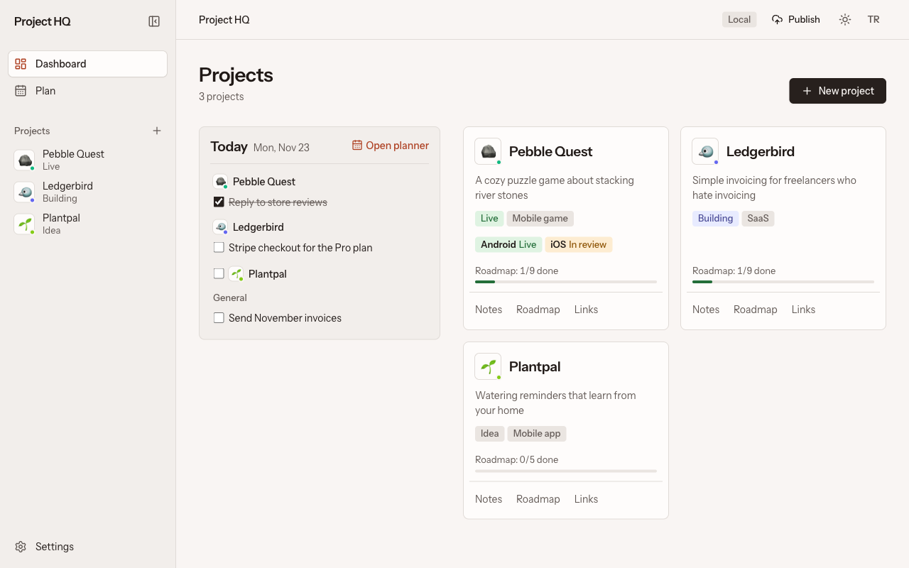

# Project HQ

Manage all your apps from one place: notes, roadmap, planner, store and ads details, and console links, stored as
Markdown in your own git repository.

[](https://github.com/EngincanV/project-hq/actions/workflows/ci.yml)
[](https://github.com/EngincanV/project-hq/releases/latest)
[](LICENSE)

[Türkçe](README.tr.md)



## What is Project HQ?

Project HQ is a small, local-first workspace for people who build and ship several apps, games or SaaS products. It
keeps the roadmap, notes, store listings, ad ids and console links for every project in one place, so you stop
switching between five tools. Everything you write is plain Markdown and JSON in a git repository that you own. A
Publish button turns your edits into a commit, and because the content is just files, you can also edit it with any
editor or a coding agent such as Claude Code. It runs in your browser or as a desktop app for macOS and Windows.

- **Projects:** a dashboard of all your apps with status and roadmap progress.
- **Notes:** a Markdown editor with split preview, task lists and images.
- **Roadmap:** a board per project, stored as a simple Markdown checklist.
- **Planner:** a week and month calendar across all projects.
- **Stores and ads:** Google Play, App Store and AdMob ids, status and links.
- **Links:** quick-launch cards for every console and dashboard.
- **Publish:** review changes and commit them with your own git.
- **Live refresh:** changes made by other tools show up within seconds.
- English and Turkish UI, light and dark themes, works on a phone.

## Getting started

There are two ways to run Project HQ. Both are the same app and keep your content in your own git repository.

| | Desktop app | From source (browser) |
| --- | --- | --- |
| Install | download from [Releases](https://github.com/EngincanV/project-hq/releases) | `git clone`, `npm install` |
| Needs | git | Node.js, npm and git |
| Opens in | its own window | your browser |
| Updates | built in | `git pull` |

Project HQ is an early `0.x` release, so expect some rough edges.

### Desktop app

1. Download the latest version from [Releases](https://github.com/EngincanV/project-hq/releases): the `.dmg` for macOS
   (`arm64` for Apple silicon, `x64` for Intel) or the `Setup .exe` for Windows.
2. Builds are unsigned, so the first launch needs one extra step:
   - **macOS:** right-click Project HQ in Applications and choose **Open**. If macOS still refuses, run
     `xattr -cr "/Applications/Project HQ.app"` once.
   - **Windows:** on the SmartScreen warning, click **More info**, then **Run anyway**.
3. Make sure [git](https://git-scm.com) is installed. The app starts with demo content.
4. Open **Settings > Local repository**, click **Choose folder** and pick your content repository (any git repository;
   Project HQ keeps its files in a `content/` folder inside it).
5. Press **Test connection** to check git and the folder, then **Save**.

More in [docs/desktop.md](docs/desktop.md): updates, where settings are stored, and building it yourself.

### From source (browser)

You need [Node.js](https://nodejs.org) 22.22+, 24.15+ or 26+ (`.nvmrc` pins 24) with npm, and
[git](https://git-scm.com) with `user.name` and `user.email` set.

```sh
git clone https://github.com/EngincanV/project-hq.git
cd project-hq
npm install
npm run setup    # creates your content repository and points the app at it
npm start        # opens on http://127.0.0.1:4173
```

Skip `npm run setup` to look around with demo content first; demo edits are thrown away when you stop the server.
Setup options and environment variables are in [docs/configuration.md](docs/configuration.md).

## How it works

Your content is plain Markdown and JSON in your own git repository, separate from this app's code. Project HQ reads and
writes those files: through a small local server bound to `127.0.0.1` when you run it from source or as the desktop
app, or through the GitHub API when you use it as a web app on your phone. Every edit is saved right away, and
**Publish** commits the content folder and pushes it with your own git credentials. The app never sees your password
or SSH key. See [docs/publishing.md](docs/publishing.md) and [docs/ARCHITECTURE.md](docs/ARCHITECTURE.md).

## Usage

- **Projects.** Create a project on the dashboard, then set its type, status, emoji and colour in **Overview**. Turn on
  the Stores and Ads tabs there when you need them.
- **Notes.** Write as many Markdown notes per project as you like. Paste or drop images; they are saved next to the
  notes. Notes save automatically.
- **Roadmap.** Add columns and cards, drag cards between columns and tick them off. Switch to the raw Markdown any time.
- **Planner.** Plan your days across all projects. Drag open roadmap cards from the backlog onto a day; today's plan
  also shows on the dashboard.
- **Stores and ads.** Keep package names, bundle ids, status, versions and AdMob ids per project. Project HQ builds the
  listing and console links; it does not call Google or Apple APIs.
- **Links.** Add quick-launch cards for Play Console, App Store Connect, Firebase, Stripe and anything else.
- **Publish.** Press `Mod+Shift+U` to see every unpublished change, discard what you do not want, and publish.

The full tour is in [docs/usage.md](docs/usage.md), and the shortcuts in
[docs/keyboard-shortcuts.md](docs/keyboard-shortcuts.md).

## Using it with Claude Code

Because your content is plain files, [Claude Code](https://docs.claude.com/en/docs/claude-code/overview) can update it
directly: tick a roadmap card when it finishes a feature, turn feedback into cards, or plan your week. The open app
picks up the changes within seconds, and you review them in the Publish panel. `npm run setup` adds a `CLAUDE.md` that
teaches agents the file formats. Read the full guide in [docs/claude-code.md](docs/claude-code.md).

## Documentation

- [Usage tour](docs/usage.md)
- [Desktop app](docs/desktop.md)
- [Configuration](docs/configuration.md): setup flags, environment variables, in-app settings
- [Publishing](docs/publishing.md): how commit and push work
- [Integrations](docs/integrations.md): GitHub, Google Play, App Store, AdMob
- [Using it on your phone (PWA)](docs/pwa.md)
- [Using it with Claude Code](docs/claude-code.md)
- [Content format](docs/content-format.md)
- [Keyboard shortcuts](docs/keyboard-shortcuts.md)
- [Security model](docs/security.md)
- [Development](docs/development.md): commands, layout, known limitations
- [Architecture](docs/ARCHITECTURE.md)
- [Releasing](docs/releasing.md) (maintainers)
- [Changelog](CHANGELOG.md)

## Contributing

Contributions are welcome. Read [CONTRIBUTING.md](CONTRIBUTING.md) before you open a pull request, and open an issue
first for larger changes. Please follow the [Code of Conduct](CODE_OF_CONDUCT.md).

## Security

Please do not report security problems in public issues. Use private vulnerability reporting as described in
[SECURITY.md](SECURITY.md).

## License

[MIT](LICENSE) © Engincan Veske
