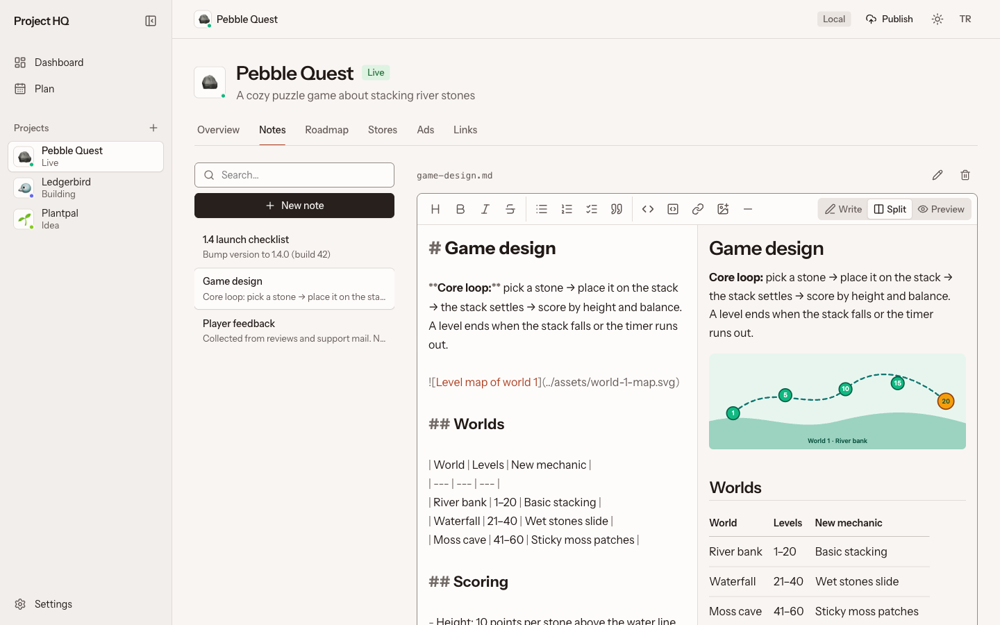

# Project HQ

[Türkçe](README.tr.md)

Project HQ is a small, calm app for running all your side projects (apps, games, SaaS) from one place:
notes, a roadmap board, a planner, store and ad tracking, and quick links to every console.
Everything you write is plain Markdown and JSON in your own git repository, and a **Publish** button turns your edits into a commit.


> **Status: early `0.1` release.** Expect rough edges. See [Known gaps](#limitations-and-known-gaps).

## Quick start

You need [Node.js](https://nodejs.org) 22.22+ or 24.15+ (see `.nvmrc`) and git.

```sh
git clone https://github.com/EngincanV/project-hq.git
cd project-hq
npm install
npm start            # serves http://127.0.0.1:4173 with demo content
```

Look around: the demo projects are there so every screen has something to show. You can edit freely;
demo edits go to a temporary copy and are gone when you stop the server, and publishing is off.

When you want your own content:

```sh
npm run setup        # creates ../project-hq-content (a git repo) and points the app at it
npm start            # restart: now you see your own (empty) workspace
```

`npm start -- --open` also opens the browser. `npm start` builds the app first when needed, so there is no separate build step.

## What you can track

- **Projects.** One folder per project with a name, emoji, colour, type (mobile game, mobile app, web app, SaaS, other) and status (idea, building, live, paused, archived). The dashboard shows them as cards with roadmap progress and store status.
- **Notes.** As many Markdown notes per project as you like, with a real editor:
  Write / Split / Preview views, a formatting toolbar and shortcuts, task lists you can tick in the preview,
  tables, code blocks, links, and images you can paste, drop or pick (they are saved next to the notes in `assets/` and linked with a relative path). Autosave, no save button.
- **Roadmap.** A board per project. Columns and cards are just `##` headings and `- [ ]` items in `roadmap.md`; add, edit, move, tick, or switch to the raw Markdown.
- **Planner.** A week and month calendar across all projects. Plan a day, tag items with a project, drag open roadmap cards from the backlog onto a day. Today's plan is also on the dashboard.
- **Stores.** Google Play and App Store per project: package / bundle id, status, version, listing and console links, plus a Markdown notes page for listing text and release checklists.
- **Ads.** AdMob ids and a notes page for ad units and experiments.
- **Links.** Quick-launch cards for consoles and dashboards (Play Console, App Store Connect, AdMob, Firebase, Stripe, Vercel…), grouped as you like. They open in a new tab; nothing is embedded.

| Notes editor (split view) | Roadmap |
| --- | --- |
|  |  |
| **Planner** | **Stores** |
|  |  |

The UI is in English and Turkish (button in the top bar), with light and dark themes, and works on a phone:


## How publishing works

Project HQ runs in one of two modes. It picks the mode by itself.

| | Local (`npm start` / `npm run dev`) | PWA (static hosting, e.g. GitHub Pages) |
| --- | --- | --- |
| Where it runs | your computer, `127.0.0.1` only | any browser, also installed on a phone |
| Edits go to | files in your content folder, right away | drafts in the browser (IndexedDB) |
| Publish does | `git commit` of the content folder, then `git push` if the repo has a remote | one commit through the GitHub API with your token |
| Needs | Node and git | a GitHub token for your content repo |

The Publish panel lists every unpublished change, suggests a commit message, and lets you discard changes one by one.
In local mode without a remote, Publish makes a local commit and says so. In PWA mode, if a file changed on GitHub
since you last loaded it, you are shown the conflicting files and can choose to keep yours.

### App repo and content repo

The app and your notes live in **two separate repositories**:

- this repo (the app) stays untouched, so `git pull` always updates cleanly;
- your content lives in its own, usually private, repo (by default `../project-hq-content`).

`npm run setup` creates the content folder, runs `git init -b main` in it, and writes `HQ_ROOT=../project-hq-content` to `.env.local`
(git-ignored). Run `npm run setup -- --help` for all options, e.g. `--dir <path>`, `--with-examples` (copy the demo projects),
`--remote <url>`, `--here` (keep content inside this repo if you use a private fork as a single repo) and `--yes` (no questions).
It never deletes anything, never creates a GitHub repo and never pushes.

To back your content up on GitHub: create an **empty private repository** on github.com, then

```sh
cd ../project-hq-content
git remote add origin https://github.com/<you>/<your-content-repo>.git
```

and press Publish in the app; the first publish pushes with `git push -u origin main`.
Publishing uses your normal git setup (credentials, SSH keys). If git has no `user.name` / `user.email` yet, set them first.

Two things worth knowing about local publishing:

- **The app never sees your credentials.** Publish runs your own `git` in the content folder, and git signs in the way it does
  in a terminal: through its credential helper (the macOS Keychain, Git Credential Manager, …) or your SSH key. No password or
  token passes through the app, the browser, or any file in this repo. Where the push goes is the content repo's own `origin`.
- **Each commit carries your git name and email**, like any commit you make by hand. If the content repo is or becomes public,
  that email is visible in its history; set a GitHub `noreply` address as `user.email` in that repo first if you want to keep it private.

## Using it on your phone (PWA)

The same build runs as an installable web app on static hosting. It talks to GitHub directly; there is no server.

1. **Fork** this repo. In your fork: *Settings → Pages → Source: GitHub Actions*, and allow workflows in the *Actions* tab
   (GitHub disables them on new forks). Then run *Actions → Deploy to GitHub Pages → Run workflow* (it also runs on every push to `main`).
   The site appears at `https://<you>.github.io/project-hq/`. Before you store a token there, read
   [Where to host it](#where-to-host-it) below: a project-site URL shares its browser storage with your other Pages sites.
   Optional: set the repository variable `HQ_CONTENT_REPO` (`owner/repo`) and `HQ_CONTENT_BRANCH` to prefill the Settings form.
2. **Create a fine-grained token** at [github.com/settings/personal-access-tokens/new](https://github.com/settings/personal-access-tokens/new):
   - Repository access: *Only select repositories* → only your **content** repo;
   - Permissions → Repository permissions → **Contents: Read and write**. Nothing else.
   - Pick an expiration date you are comfortable with.
3. Open the site, enter the content repo and the token in **Settings**, press *Test connection*, then *Save*.
4. **Install it:** on Android (Chrome) use *Install app* / *Add to Home screen*; on iPhone (Safari) use *Share → Add to Home Screen*.

Your edits are kept as drafts in that browser until you publish. To load changes made elsewhere, use *Refresh* in the Publish panel.

### Where to host it

Browsers keep `localStorage` and IndexedDB (where the token and the offline copy of your notes live) per *origin*: scheme plus
host, without the path. Every GitHub Pages project site of an account, `https://<you>.github.io/<any-repo>/`, has the same origin
`https://<you>.github.io`. So any other project site you publish there, now or later, could read the token and notes stored by
Project HQ. The app shows a warning in Settings when it runs from such a URL.

Give the app an origin of its own instead, any of:

- a **custom (sub)domain** for this Pages site (*Settings → Pages → Custom domain*, e.g. `hq.example.com`);
- a **`<you>.github.io` root repository** used only for this app (served at `https://<you>.github.io/`; then don't host other
  user-site content there);
- a **static host that gives each site its own subdomain** (e.g. `<project>.<host>.app`-style URLs).

## Content format

Everything is hand-editable and reads well on GitHub. All paths are inside `content/`:

```
content/
  projects/<slug>/
    project.json        name, type, status, emoji, colour, store ids, links…
    roadmap.md          the roadmap board
    notes/<note>.md     notes; the title is the first "# " heading
    stores/android.md   Play Store notes
    stores/ios.md       App Store notes
    ads/admob.md        AdMob notes
    assets/<image>      images used by the notes (relative links)
  plan/<YYYY-MM>.md     the planner, one file per month
```

There are three Markdown formats the app understands. Anything else in these files is kept as is.

**Notes**: any Markdown. The first `# ` heading is the title.

**Roadmap** (`roadmap.md`): every `## ` heading is a column, every top-level task item a card; indented lines are the card's details.

```md
# Roadmap

## Now
- [ ] Daily challenge mode
  One hand-made level per day.
- [x] Haptics on stone landing

## Next
- [ ] Rewarded ad for an extra undo
```

**Planner** (`plan/2026-11.md`): every `## YYYY-MM-DD` heading is a day; a trailing `#<project-slug>` ties an item to a project.

```md
# 2026-11

## 2026-11-23
- [ ] Stripe checkout for the Pro plan #ledgerbird
- [x] Reply to store reviews #pebble-quest
- [ ] Send November invoices
```

The demo content in [`content/`](content/) shows every format.

## Keyboard shortcuts

`Mod` is ⌘ on macOS and Ctrl elsewhere.

| Where | Keys | Does |
| --- | --- | --- |
| Anywhere | `Mod+Shift+U` | open the Publish panel |
| Publish panel | `Mod+Enter` | publish |
| Editor | `Mod+B` / `Mod+I` / `Mod+Shift+X` | bold / italic / strikethrough |
| Editor | `Mod+E` / `Mod+K` | inline code / link |
| Editor | `Mod+Shift+7` / `8` / `9` | numbered / bullet / task list |
| Editor | `Mod+Alt+1` / `2` / `3` / `0` | heading 1–3 / plain text |
| Editor | `Mod+Z` / `Mod+Shift+Z` | undo / redo |
| Roadmap, planner | `Enter` / `Esc` | add the typed card or item / cancel |

## Security notes

- The local server listens on `127.0.0.1` only and accepts only `localhost`-style `Host` headers (on the API and on the static files
  of `npm start`). Every API request, reads included, is refused when it carries an `Origin` other than the server's own host or
  `Sec-Fetch-Site: cross-site` / `same-site`, so other sites and other local ports (`*.localhost`, another dev server) cannot read your
  content. The API never sends CORS headers, and the dev / preview servers run with Vite's CORS turned off. Writes also need a custom header.
- Paths outside the content folder are refused (no `..`, no dot-files, symlinks resolved). Git is run with argument arrays, never
  through a shell, and with literal pathspecs (a file named `*.md` is just that file).
- The dev and preview servers never serve the content folder as static files (`/content/…`, `/@fs/…` and encoded variants answer 404);
  content is only read through the API, which sends a sandboxing Content-Security-Policy.
- In PWA mode your GitHub token is stored in the browser's `localStorage` for that site. Anyone who can run JavaScript on that origin
  (for example a malicious browser extension, another site on the same origin, or someone using your unlocked device) could read it.
  Serve the app from an origin of its own (see [Where to host it](#where-to-host-it)). Use a fine-grained token limited to
  the content repo with *Contents* permission only, give it an expiration date, and use *Settings → Disconnect* to remove it, its cache and drafts from a browser.
- Nothing is embedded or sent anywhere except GitHub: no analytics, no third-party scripts, no iframes. The production build sets a Content-Security-Policy that allows network requests only to the app itself and `api.github.com`.
- Note previews are sanitized (DOMPurify) before they are shown. Links that point into the app's own origin (relative paths, `/…`)
  are shown as plain text, so a file from the content repo is never opened as a page of the app; `#…` links and links to other
  sites work. SVG images are cleaned (no scripts, event handlers, `foreignObject` or external references) before they are shown.
- `project.json` colours are used only when they are hex values (`#rgb`, `#rrggbb`, with or without alpha); anything else is ignored
  but kept in the file.

## Development

```sh
npm run dev          # Vite dev server with the local API (hot reload)
npm test             # unit and integration tests (Vitest)
npm run typecheck    # TypeScript
npm run build        # type-check and production build into dist/
npm run sandbox -- 5190   # dev server on a throw-away git copy of the demo content (publishing works)
```

`npm run dev` follows the same rule as `npm start`: demo content until `npm run setup` has been run (or `HQ_ROOT` is set).
The code is React + TypeScript with plain CSS modules and a zero-dependency Node server. Start with [docs/ARCHITECTURE.md](docs/ARCHITECTURE.md);
contributions are welcome, see [CONTRIBUTING.md](CONTRIBUTING.md).

## Limitations and known gaps

- This is a `0.1` release.
- Publishing through the GitHub API (PWA mode) has so far only been tested against a simulated GitHub in the test suite, not against github.com.
- The GitHub Pages deploy workflow has not run yet.
- One person, one content repo: there are no accounts, sharing or real-time collaboration. Conflicts are detected per file, not merged.
- Local mode needs Node and git on the machine; PWA mode needs a GitHub account and token.
- The planner's demo days move with the current date, but the rest of the demo content is static.
- UI languages: English and Turkish.

## License

[MIT](LICENSE) © Engincan Veske
