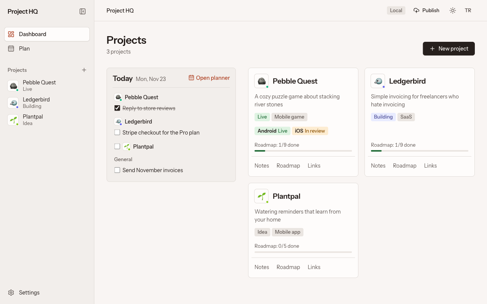
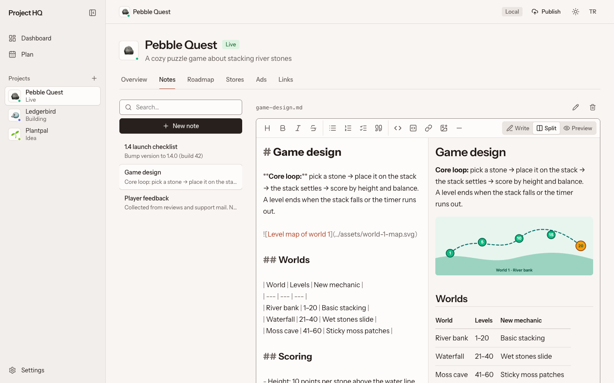
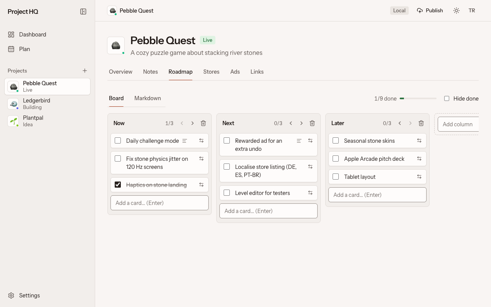
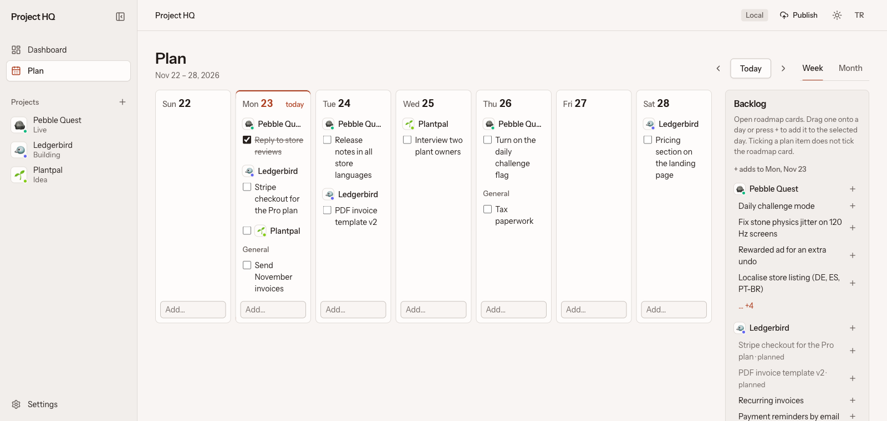
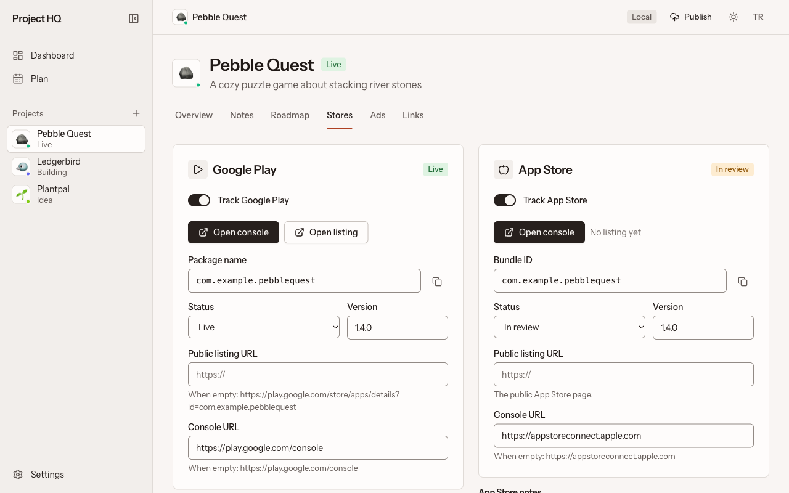
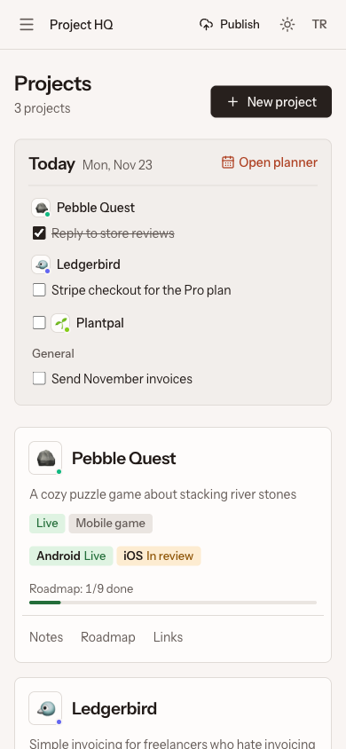

# Project HQ

[English](README.md) · *En güncel ve ayrıntılı belge İngilizce README'dir (entegrasyonlar, mimari, katkı rehberi).*

Project HQ, tüm yan projelerini (uygulamalar, oyunlar, SaaS) tek yerden yönetmek için küçük ve sakin bir uygulama:
notlar, yol haritası panosu, takvim, mağaza ve reklam takibi, her konsola hızlı bağlantılar.
Yazdığın her şey kendi git deponda düz Markdown ve JSON olarak durur; **Yayınla** düğmesi düzenlemelerini bir commit'e çevirir.



> **Durum: erken `0.1` sürümü.** Pürüzler olabilir. Bkz. [Bilinen eksikler](#sınırlar-ve-bilinen-eksikler).

## İki çalıştırma yolu

İkisi de aynı koddan çıkan aynı uygulamadır ve içeriğini kendi git deponda tutar:

| | Masaüstü uygulaması | Kaynaktan (tarayıcıda) |
| --- | --- | --- |
| Kurulum | [Releases](https://github.com/EngincanV/project-hq/releases) sayfasından yükleyiciyi indir | clone, `npm install`, `npm start` |
| Gerekenler | git | Node.js, npm ve git |
| Açıldığı yer | kendi penceresi | tarayıcıda `http://127.0.0.1:4173` |
| Ayarların yeri | uygulama veri klasöründeki `settings.json` | uygulama klasöründeki `.env.local` |
| Güncelleme | yerleşik (bkz. [Güncellemeler](#güncellemeler)) | `git pull` |

## Masaüstü uygulaması (macOS ve Windows)

### İndirme ve kurulum

Son sürümü [GitHub Releases](https://github.com/EngincanV/project-hq/releases) sayfasından indir:

- **macOS:** Apple silicon (M1 ve sonrası) için `Project-HQ-<sürüm>-mac-arm64.dmg`, Intel Mac için `…-mac-x64.dmg`.
  dmg'yi aç ve **Project HQ**'yu **Uygulamalar** klasörüne sürükle.
- **Windows:** `Project-HQ-Setup-<sürüm>.exe`. Yalnızca senin kullanıcın için kurulur (yönetici yetkisi gerekmez) ve
  Başlat menüsüne kısayol ekler.

### İmzasız sürümün ilk açılışı

Bakımcı imza sertifikası eklemediği sürece sürümler imzasızdır; işletim sistemi ilk açılışta uyarır:

- **macOS** "geliştirici doğrulanamadığı için açılamıyor" (ya da "hasarlı") der. Finder'da Uygulamalar içindeki
  **Project HQ**'ya **sağ tıkla** (ya da Control-tık) → **Aç** → **Aç**. macOS yine reddederse Terminal'de bir kez şunu
  çalıştırıp uygulamayı yeniden aç:

  ```sh
  xattr -cr "/Applications/Project HQ.app"
  ```

- **Windows** "Windows bilgisayarınızı korudu" (SmartScreen) der. **Ek bilgi** → **Yine de çalıştır**'a tıkla.

Bunu her kurulu sürüm için yalnızca bir kez yaparsın.

### git kurulu olmalı

Masaüstü uygulaması Yayınla, Vazgeç ve Yenile için `npm start` gibi senin `git`'ini kullanır.

- macOS: `xcode-select --install` çalıştır ya da [Homebrew](https://brew.sh) ile kur (`brew install git`).
- Windows: [Git for Windows](https://git-scm.com/download/win) kur.

Finder'dan ya da Başlat menüsünden açılan uygulamalar terminalindeki `PATH`'i görmez. Project HQ bunu açılışta düzeltir:
macOS'te giriş kabuğunun `PATH` (ve `SSH_AUTH_SOCK`) değerini okur, ayrıca `/opt/homebrew/bin` ve `/usr/local/bin`'e bakar;
Windows'ta standart Git for Windows ve GitHub CLI klasörlerine bakar. SSH ajanın, macOS anahtar zinciri, Git Credential
Manager ve kimlik yardımcısı olarak `gh` çalışmaya devam eder.

Denetlemek için **Ayarlar → Yerel depo**'da bir klasör yaz ya da seç ve **Bağlantıyı test et**'e bas. git'in bulunup
bulunmadığını (ve sürümünü), klasörün git deposu olup olmadığını, dalını, uzak deposunu ve içerik dosyası sayısını gösterir.
"Git bulunamadı" görürsen git'i yukarıdaki gibi kur ve uygulamayı yeniden başlat.

### İçerik klasörünü seçmek

İlk açılış demo içeriği gösterir. **Ayarlar → Yerel depo**'da **Klasör seç**'e tıkla ve içerik deponu seç (`content/`
klasörünü barındıran klasör; bir clone'da `npm run setup` ile oluşturabilir ya da herhangi bir git deposunu kullanabilirsin).
**Bağlantıyı test et**, sonra **Kaydet**: uygulama yeniden başlatmadan hemen o klasöre geçer.

### Masaüstü ayarları nerede saklanır

| İşletim sistemi | Klasör |
| --- | --- |
| macOS | `~/Library/Application Support/Project HQ/` |
| Windows | `%APPDATA%\Project HQ\` (ör. `C:\Users\<sen>\AppData\Roaming\Project HQ\`) |

`settings.json` içerik klasörünü (`root`, `contentDir`) ve son kullanılan portu, `window-state.json` pencere boyutunu ve
konumunu tutar. Uygulama `.env.local`'ı ya da ortam değişkenlerini okumaz. Tema, dil ve GitHub modu taslakları aynı
klasördeki tarayıcı depolamasında durur. Geliştirme çalıştırmaları (`npm run desktop:dev`) `Project HQ (dev)` klasörünü kullanır.

### Oturum açınca başlat

**Ayarlar → Masaüstü uygulaması → Oturum açınca başlat**, oturum açtığında Project HQ'yu başlatır. Aynı bölüm kurulu sürümü gösterir.

### Güncellemeler

Uygulama açıldıktan kısa süre sonra ve altı saatte bir GitHub Releases'ı kontrol eder (yalnızca yayınlanmış sürümler).

- **Windows** (ve **imzalı** macOS sürümleri): güncelleme arka planda iner; küçük bir uyarı **Yeniden başlat** önerir,
  yoksa bir sonraki çıkışta kurulur.
- **İmzasız macOS sürümleri** kendini güncelleyemez (macOS buna yalnızca imzalı uygulamalarda izin verir); küçük bir
  uyarı yeni sürümü sürüm sayfasına giden **İndir** bağlantısıyla gösterir. İlk kurulumdaki gibi kurarsın.

**Help → Check for Updates…** (macOS'te **Project HQ → Check for Updates…**) hemen kontrol eder.

### Kaynaktan çalıştırma ve derleme

```sh
npm install
npm run desktop:dev      # Vite geliştirme sunucusunda Electron penceresi, anında yenilemeyle
npm run desktop:build    # web uygulamasını, sonra bu işletim sistemi için yükleyiciyi release/ içine derler
npm run desktop:smoke    # ana süreci --smoke-test ile başlatır: /api/health ve preload'u denetler, 0 ya da 1 ile çıkar
```

### Tek kod tabanı

Masaüstü uygulaması ikinci bir uygulama değildir: `electron/main.mjs`, `npm start` ile aynı `startServer()`'ı çağırır ve
bir pencerede açar. React uygulaması, yerel API, içerik biçimi ve güvenlik kuralları ortaktır. Masaüstüne özel olanlar
`electron/` içindeki dosyalar, `server/config.mjs`'deki `settings.json` kolu ve yalnızca `window.hq` varken görünen birkaç
arayüz parçasıdır (Klasör seç, Oturum açınca başlat, sürüm, güncelleme uyarısı). Web sürümü eskisi gibi çalışır.

## Kaynaktan hızlı başlangıç (tarayıcıda)

[Node.js](https://nodejs.org) 22.22+ ya da 24.15+ (bkz. `.nvmrc`) ve git gerekir.

```sh
git clone https://github.com/EngincanV/project-hq.git
cd project-hq
npm install
npm start            # demo içerikle http://127.0.0.1:4173 adresinde açılır
```

Etrafa bak: demo projeler her ekranda gösterecek bir şey olsun diye var. İstediğin gibi düzenleyebilirsin;
demo düzenlemeleri geçici bir kopyaya yazılır ve sunucuyu durdurunca silinir, yayınlama kapalıdır.

Kendi içeriğine geçmek için:

```sh
npm run setup        # ../project-hq-content (bir git deposu) oluşturur ve uygulamayı ona yönlendirir
npm start            # yeniden başlat: artık kendi (boş) çalışma alanını görürsün
```

`npm start -- --open` tarayıcıyı da açar. `npm start` gerektiğinde uygulamayı önce derler; ayrı bir build adımı yoktur.

## Neleri takip edebilirsin

- **Projeler.** Her proje bir klasör: ad, emoji, renk, tür (mobil oyun, mobil uygulama, web uygulaması, SaaS, diğer) ve durum (fikir, geliştiriliyor, yayında, beklemede, arşiv). Panel bunları yol haritası ilerlemesi ve mağaza durumuyla kartlar halinde gösterir.
- **Notlar.** Proje başına istediğin kadar Markdown notu, gerçek bir editörle:
  Yaz / Böl / Önizleme görünümleri, biçimlendirme araç çubuğu ve kısayolları, önizlemede işaretlenebilen görev listeleri,
  tablolar, kod blokları, bağlantılar ve yapıştırıp sürükleyip ya da seçip ekleyebildiğin görseller (notların yanında `assets/` klasörüne kaydedilir, göreli yolla bağlanır). Otomatik kayıt; kaydet düğmesi yok.
- **Yol haritası.** Proje başına bir pano. Sütunlar ve kartlar `roadmap.md` içindeki `##` başlıkları ve `- [ ]` maddeleridir; ekle, düzenle, taşı, işaretle ya da ham Markdown'a geç.
- **Takvim.** Tüm projeler için haftalık ve aylık takvim. Bir günü planla, maddeleri bir projeyle etiketle, açık yol haritası kartlarını bekleme listesinden bir güne sürükle. Bugünün planı panelde de görünür.
- **Mağazalar.** Proje başına Google Play ve App Store: paket / bundle kimliği, durum, sürüm, mağaza ve konsol bağlantıları; ayrıca mağaza metni ve sürüm kontrol listesi için bir Markdown not sayfası.
- **Reklamlar.** AdMob kimlikleri ve reklam birimleri ile deneyler için bir not sayfası.
- **Bağlantılar.** Konsollar ve paneller için hızlı açma kartları (Play Console, App Store Connect, AdMob, Firebase, Stripe, Vercel…), istediğin gibi gruplanır. Yeni sekmede açılırlar; hiçbir şey sayfaya gömülmez.

| Not editörü (bölünmüş görünüm) | Yol haritası |
| --- | --- |
|  |  |
| **Takvim** | **Mağazalar** |
|  |  |

Arayüz Türkçe ve İngilizcedir (üst çubuktaki düğme), açık ve koyu tema vardır ve telefonda da çalışır:



## Yayınlama nasıl çalışır

Project HQ iki moddan birinde çalışır; modu kendisi seçer.

| | Yerel (`npm start` / `npm run dev`) | PWA (statik barındırma, ör. GitHub Pages) |
| --- | --- | --- |
| Nerede çalışır | kendi bilgisayarında, yalnızca `127.0.0.1` | herhangi bir tarayıcıda, telefona kurulu olarak da |
| Düzenlemeler | anında içerik klasöründeki dosyalara | tarayıcıda taslak olarak (IndexedDB) |
| Yayınla | içerik klasörünü `git commit` eder, depoda uzak depo (remote) varsa `git push` eder | token'ınla GitHub API üzerinden tek bir commit |
| Gerekenler | Node ve git | içerik deponu için bir GitHub token'ı |

Yayınla paneli yayınlanmamış her değişikliği listeler, bir commit mesajı önerir ve değişiklikleri tek tek geri almana izin verir.
Yerel modda uzak depo yoksa Yayınla yerel bir commit oluşturur ve bunu söyler. PWA modunda bir dosya sen son yüklediğinden beri
GitHub'da değiştiyse çakışan dosyalar gösterilir ve kendi sürümünü koruyup korumayacağını seçebilirsin.

### Uygulama deposu ve içerik deposu

Uygulama ve notların **iki ayrı depoda** durur:

- bu depo (uygulama) değişmeden kalır, böylece `git pull` her zaman temiz günceller;
- içeriğin kendi, genellikle özel (private) deposunda durur (varsayılan: `../project-hq-content`).

`npm run setup` içerik klasörünü oluşturur, içinde `git init -b main` çalıştırır ve `.env.local` dosyasına (git'e girmez)
`HQ_ROOT=../project-hq-content` yazar. Tüm seçenekler için `npm run setup -- --help`: ör. `--dir <yol>`, `--with-examples` (demo projeleri kopyalar),
`--remote <url>`, `--here` (özel bir fork'u tek depo olarak kullanıyorsan içeriği bu depoda tutar) ve `--yes` (soru sormaz).
Hiçbir şeyi silmez, GitHub'da depo oluşturmaz ve push etmez.

İçeriğini GitHub'a yedeklemek için github.com'da **boş, özel bir depo** oluştur, sonra

```sh
cd ../project-hq-content
git remote add origin https://github.com/<you>/<your-content-repo>.git
```

ve uygulamada Yayınla'ya bas; ilk yayınlama `git push -u origin main` ile gönderir.
Yayınlama normal git kurulumunu (kimlik bilgileri, SSH anahtarları) kullanır. git'te henüz `user.name` / `user.email` yoksa önce bunları ayarla.

Yerel yayınlama hakkında bilinmesi gereken iki şey:

- **Uygulama kimlik bilgilerini hiç görmez.** Yayınla, içerik klasöründe senin kendi `git` komutunu çalıştırır; git de terminaldeki
  gibi oturum açar: kimlik deposu (macOS Anahtar Zinciri, Git Credential Manager, …) ya da SSH anahtarın üzerinden. Hiçbir şifre ya da
  token uygulamadan, tarayıcıdan ya da bu depodaki bir dosyadan geçmez. Gönderimin nereye gideceğini içerik deposunun kendi `origin` adresi belirler.
- **Her commit git adını ve e-postanı taşır**, elle attığın her commit gibi. İçerik deposu herkese açıksa ya da açılırsa bu e-posta
  geçmişte görünür; gizli kalsın istiyorsan önce o depoda `user.email` olarak bir GitHub `noreply` adresi ayarla.

## Yapılandırma

Kodda kullanıcıya özel değer (depo, kullanıcı adı, uygulama kimliği, yol) yoktur. Sunucu ayarları ortam değişkenleri ya da
git'e girmeyen `.env.local` dosyasıyla verilir; tüm değişkenler [`.env.example`](.env.example) içinde açıklanmıştır.

| Değişken | Varsayılan | Ne işe yarar |
| --- | --- | --- |
| `HQ_ROOT` | *(boş → demo modu)* | İçerik git deposunun klasörü. `npm run setup` yazar. |
| `HQ_CONTENT_DIR` | `content` | `HQ_ROOT` içindeki içerik klasörü. |
| `PORT` | `4173` | `npm start` portu (yalnızca `127.0.0.1`). |
| `HQ_WATCH_INTERVAL_MS` | `3000` | Açık uygulamanın içerik klasöründeki dış değişiklikleri ne sıklıkla kontrol edeceği; `0` kapatır. |
| `VITE_HQ_REPO`, `VITE_HQ_BRANCH` | boş, `main` | PWA derlemesinde Ayarlar formunu önceden doldurur (herkese açık pakete girer; token koyma). |

Uygulama içinde: GitHub bağlantısı (PWA), tema ve dil tarayıcıda; proje bilgileri, mağaza ve AdMob kimlikleri, bağlantılar
kendi içerik deponda (`project.json`) saklanır. Yerel modda **Ayarlar → Yerel depo** içerik klasörünün tam yolunu gösterir;
buradan başka bir klasör seçip **Bağlantıyı test et** ve **Kaydet** ile yeniden başlatmadan geçebilirsin. Kaynaktan
çalışırken seçim `.env.local`'a (`HQ_ROOT`, `HQ_CONTENT_DIR`), masaüstü uygulamasında `settings.json`'a yazılır.
`HQ_ROOT` ortam değişkeni olarak tanımlıysa o geçerlidir ve form bunu söyler.

## Claude Code ile kullanmak

İçerik düz dosyalardan oluştuğu için [Claude Code](https://docs.claude.com/en/docs/claude-code/overview) onu doğrudan
okuyup güncelleyebilir; yerel modda açık uygulama değişiklikleri birkaç saniye içinde kendiliğinden gösterir ve Yayınla
panelinde listeler.

1. `npm run setup` ile kendi içerik deponu oluştur (Claude Code'a biçimleri anlatan bir `CLAUDE.md` ekler), `npm start` çalıştır.
2. Uygulamada projenin **Genel bakış** sekmesine kod deposunun bağlantısını ekle; projenin kısa adını (`#/p/<slug>`) not et.
3. **Ayarlar → Yerel depo**'dan içerik klasörünün yolunu kopyala.
4. Kod deposunda: `claude --add-dir /içerik/deposu/yolu` ve örneğin "Günlük meydan okuma modunu yaz, sonra Project HQ'daki
   yol haritası kartını işaretle" de. Kart birkaç saniye içinde işaretli görünür; değişiklikleri Yayınla panelinden gözden
   geçirip yayınlarsın.

Aynı dosyayı aynı anda hem uygulamada hem Claude Code'da düzenleme: son yazan kazanır. PWA modunda otomatik yenileme yoktur
(Yayınla panelinde *Yenile*). Ayrıntılar İngilizce README'de.

## Telefonda kullanmak (PWA)

Aynı derleme statik barındırmada kurulabilir bir web uygulaması olarak çalışır. Doğrudan GitHub ile konuşur; sunucu yoktur.

1. Bu depoyu **fork'la**. Fork'unda: *Settings → Pages → Source: GitHub Actions*, ve *Actions* sekmesinde iş akışlarına izin ver
   (GitHub yeni fork'larda bunları kapatır). Sonra *Actions → Deploy to GitHub Pages → Run workflow* çalıştır (`main`'e her push'ta da çalışır).
   Site `https://<you>.github.io/project-hq/` adresinde açılır. Oraya token kaydetmeden önce aşağıdaki
   [Nerede barındırmalı](#nerede-barındırmalı) bölümünü oku: bir proje sitesi adresi, tarayıcı depolamasını diğer Pages sitelerinle paylaşır.
   İsteğe bağlı: Ayarlar formunu önceden doldurmak için `HQ_CONTENT_REPO` (`owner/repo`) ve `HQ_CONTENT_BRANCH` depo değişkenlerini tanımla.
2. [github.com/settings/personal-access-tokens/new](https://github.com/settings/personal-access-tokens/new) adresinde **ince ayarlı (fine-grained) bir token oluştur**:
   - Repository access: *Only select repositories* → yalnızca **içerik** deponu;
   - Permissions → Repository permissions → **Contents: Read and write**. Başka hiçbir şey gerekmez.
   - İçinin rahat edeceği bir son kullanma tarihi seç.
3. Siteyi aç, **Ayarlar**'a içerik deposunu ve token'ı gir, *Bağlantıyı test et*'e, sonra *Kaydet*'e bas.
4. **Kur:** Android'de (Chrome) *Uygulamayı yükle* / *Ana ekrana ekle*; iPhone'da (Safari) *Paylaş → Ana Ekrana Ekle*.

Düzenlemelerin yayınlayana kadar o tarayıcıda taslak olarak kalır. Başka yerde yapılan değişiklikleri almak için Yayınla panelindeki *Yenile*'yi kullan.

### Nerede barındırmalı

Tarayıcılar `localStorage` ve IndexedDB'yi (token'ın ve notlarının çevrimdışı kopyasının durduğu yer) *kaynak* (origin) başına tutar:
şema artı alan adı, yol hariç. Bir hesabın tüm GitHub Pages proje siteleri, `https://<you>.github.io/<herhangi-bir-depo>/`, aynı kaynağa
sahiptir: `https://<you>.github.io`. Yani orada yayınladığın (şimdi ya da ileride) başka herhangi bir proje sitesi, Project HQ'nun
sakladığı token'ı ve notları okuyabilir. Uygulama böyle bir adresten çalıştığında Ayarlar'da bir uyarı gösterir.

Bunun yerine uygulamaya kendine ait bir kaynak ver; şunlardan biri olur:

- bu Pages sitesi için **özel bir (alt) alan adı** (*Settings → Pages → Custom domain*, ör. `hq.example.com`);
- yalnızca bu uygulama için kullanılan bir **`<you>.github.io` kök deposu** (`https://<you>.github.io/` adresinde sunulur; o zaman
  oraya başka kullanıcı sitesi içeriği koyma);
- **her siteye kendi alt alan adını veren bir statik barındırma** (ör. `<proje>.<host>.app` biçimli adresler).

## İçerik biçimi

Her şey elle düzenlenebilir ve GitHub'da rahat okunur. Tüm yollar `content/` içindedir:

```
content/
  projects/<slug>/
    project.json        ad, tür, durum, emoji, renk, mağaza kimlikleri, bağlantılar…
    roadmap.md          yol haritası panosu
    notes/<not>.md      notlar; başlık ilk "# " satırıdır
    stores/android.md   Play Store notları
    stores/ios.md       App Store notları
    ads/admob.md        AdMob notları
    assets/<görsel>     notlarda kullanılan görseller (göreli bağlantılar)
  plan/<YYYY-MM>.md     takvim, ay başına bir dosya
```

Uygulamanın anladığı üç Markdown biçimi var. Bu dosyalardaki diğer her şey olduğu gibi korunur.

**Notlar**: herhangi bir Markdown. İlk `# ` başlığı notun başlığıdır.

**Yol haritası** (`roadmap.md`): her `## ` başlığı bir sütun, her üst düzey görev maddesi bir karttır; girintili satırlar kartın ayrıntılarıdır.

```md
# Roadmap

## Now
- [ ] Daily challenge mode
  One hand-made level per day.
- [x] Haptics on stone landing

## Next
- [ ] Rewarded ad for an extra undo
```

**Takvim** (`plan/2026-11.md`): her `## YYYY-AA-GG` başlığı bir gündür; sondaki `#<proje-slug>` maddeyi bir projeye bağlar.

```md
# 2026-11

## 2026-11-23
- [ ] Stripe checkout for the Pro plan #ledgerbird
- [x] Reply to store reviews #pebble-quest
- [ ] Send November invoices
```

[`content/`](content/) klasöründeki demo içerik her biçimi gösterir.

## Klavye kısayolları

`Mod`, macOS'ta ⌘, diğerlerinde Ctrl'dir.

| Nerede | Tuşlar | Ne yapar |
| --- | --- | --- |
| Her yerde | `Mod+Shift+U` | Yayınla panelini açar |
| Yayınla paneli | `Mod+Enter` | yayınlar |
| Editör | `Mod+B` / `Mod+I` / `Mod+Shift+X` | kalın / italik / üstü çizili |
| Editör | `Mod+E` / `Mod+K` | satır içi kod / bağlantı |
| Editör | `Mod+Shift+7` / `8` / `9` | numaralı / madde işaretli / görev listesi |
| Editör | `Mod+Alt+1` / `2` / `3` / `0` | başlık 1–3 / düz metin |
| Editör | `Mod+Z` / `Mod+Shift+Z` | geri al / yinele |
| Yol haritası, takvim | `Enter` / `Esc` | yazılan kartı ya da maddeyi ekler / vazgeçer |

## Güvenlik notları

- Yerel sunucu yalnızca `127.0.0.1` üzerinde dinler ve yalnızca `localhost` benzeri `Host` başlıklarını kabul eder (API'de ve `npm start`'ın
  statik dosyalarında). Okumalar dahil her API isteği, sunucunun kendi adresi dışında bir `Origin` ya da `Sec-Fetch-Site: cross-site` /
  `same-site` taşıyorsa reddedilir; böylece başka siteler ve başka yerel portlar (`*.localhost`, başka bir geliştirme sunucusu) içeriğini okuyamaz.
  API hiçbir zaman CORS başlığı göndermez; geliştirme ve önizleme sunucuları Vite'ın CORS desteği kapalı çalışır. Yazma işlemleri ayrıca özel bir başlık ister.
- İçerik klasörü dışındaki yollar reddedilir (`..` yok, nokta ile başlayan dosya yok, sembolik bağlar çözülür). Git, kabuk üzerinden değil
  argüman dizileriyle ve birebir (literal) yol eşleşmesiyle çalıştırılır (`*.md` adlı bir dosya yalnızca o dosyadır).
- Geliştirme ve önizleme sunucuları içerik klasörünü hiçbir zaman statik dosya olarak sunmaz (`/content/…`, `/@fs/…` ve kodlanmış biçimleri
  404 döner); içerik yalnızca API üzerinden okunur ve API sandbox'lı bir Content-Security-Policy gönderir.
- PWA modunda GitHub token'ın o sitenin tarayıcı `localStorage`'ında saklanır. O kaynakta JavaScript çalıştırabilen herkes
  (ör. kötü niyetli bir tarayıcı eklentisi, aynı kaynaktaki başka bir site ya da kilidi açık cihazını kullanan biri) onu okuyabilir.
  Uygulamayı kendine ait bir kaynaktan sun (bkz. [Nerede barındırmalı](#nerede-barındırmalı)). Yalnızca içerik deposuyla ve yalnızca
  *Contents* izniyle sınırlı, son kullanma tarihi olan bir fine-grained token kullan; bir tarayıcıdan token'ı, önbelleği ve taslakları silmek için *Ayarlar → Bağlantıyı kes*'i kullan.
- Hiçbir şey sayfaya gömülmez ve GitHub dışında hiçbir yere gönderilmez: analitik yok, üçüncü taraf betik yok, iframe yok. Üretim derlemesi, ağ isteklerine yalnızca uygulamanın kendisine ve `api.github.com`'a izin veren bir Content-Security-Policy kullanır.
- Not önizlemeleri gösterilmeden önce temizlenir (DOMPurify). Uygulamanın kendi kaynağına işaret eden bağlantılar (göreli yollar, `/…`)
  düz metin olarak gösterilir; böylece içerik deposundaki bir dosya hiçbir zaman uygulamanın bir sayfası olarak açılmaz. `#…` bağlantıları
  ve başka sitelere giden bağlantılar çalışır. SVG görseller gösterilmeden önce temizlenir (betik, olay işleyicisi, `foreignObject` ve dış başvuru yok).
- `project.json` içindeki renkler yalnızca hex değerse (`#rgb`, `#rrggbb`, alfa ile ya da alfasız) kullanılır; diğer değerler yok sayılır
  ama dosyada korunur.

## Geliştirme

```sh
npm run dev          # yerel API ile Vite geliştirme sunucusu (anında yenileme)
npm test             # birim ve entegrasyon testleri (Vitest)
npm run typecheck    # TypeScript
npm run build        # tip denetimi ve dist/ içine üretim derlemesi
npm run sandbox -- 5190   # demo içeriğin atılabilir bir git kopyasında geliştirme sunucusu (yayınlama çalışır)
```

`npm run dev` de `npm start` ile aynı kuralı izler: Ayarlar'dan bir klasör seçilene, `npm run setup` çalıştırılana (ya da `HQ_ROOT`
ayarlanana) kadar demo içerik gösterir. Masaüstü komutları için bkz. [Kaynaktan çalıştırma ve derleme](#kaynaktan-çalıştırma-ve-derleme).

### Sürüm çıkarmak (bakımcılar)

1. `package.json` içindeki `"version"` değerini ayarla (ör. `0.2.0`), commit'le, sonra etiketi oluşturup gönder:
   `git tag v0.2.0 && git push origin v0.2.0`.
2. [`.github/workflows/desktop-release.yml`](.github/workflows/desktop-release.yml) testleri çalıştırır, `macos-latest`
   (dmg + zip, arm64 ve x64) ve `windows-latest` (yükleyici) üzerinde derler ve güncelleyici için `latest*.yml` dahil her
   şeyi **taslak** bir sürüme yükler. Etiket `package.json` sürümüyle aynı olmalı.
3. Releases sayfasında taslağı kontrol et, notları düzenle ve **Publish**'e bas. Kurulu uygulamalar yeni sürümü ancak o zaman görür.

İmzalama isteğe bağlıdır; bu depo sırları yoksa sürümler imzasız derlenir ve yine çalışır: `MAC_CSC_LINK`,
`MAC_CSC_KEY_PASSWORD` (macOS Developer ID sertifikası, base64 `.p12` ve şifresi), `APPLE_ID`, `APPLE_APP_SPECIFIC_PASSWORD`,
`APPLE_TEAM_ID` (notarization), `WIN_CSC_LINK`, `WIN_CSC_KEY_PASSWORD` (Windows imza sertifikası). Ayrıntılar İngilizce README'de.
Kod React + TypeScript, düz CSS modülleri ve bağımlılıksız bir Node sunucusundan oluşur. [docs/ARCHITECTURE.md](docs/ARCHITECTURE.md) ile başla;
katkılar memnuniyetle karşılanır, bkz. [CONTRIBUTING.md](CONTRIBUTING.md).

## Sınırlar ve bilinen eksikler

- Bu bir `0.1` sürümü.
- GitHub API üzerinden yayınlama (PWA modu) şimdiye kadar yalnızca test paketindeki simüle edilmiş bir GitHub'a karşı denendi, github.com'a karşı değil.
- GitHub Pages dağıtım iş akışı henüz hiç çalışmadı.
- Tek kişi, tek içerik deposu: hesaplar, paylaşım ya da gerçek zamanlı ortak çalışma yok. Çakışmalar dosya bazında algılanır, birleştirilmez.
- Yerel mod bilgisayarda git ister (kaynaktan çalışırken Node da); PWA modu bir GitHub hesabı ve token ister.
- Masaüstü sürümleri imza sırları tanımlanmadıkça imzasızdır: yukarıdaki ilk açılış uyarılarını bekle; macOS'te kendini
  güncelleme yok. Henüz Linux paketi yok (kaynaktan çalıştır).
- Demo takvimdeki günler bugünün tarihine göre kayar, ama demo içeriğin geri kalanı sabittir.
- Arayüz dilleri: Türkçe ve İngilizce.

## Lisans

[MIT](LICENSE) © Engincan Veske
