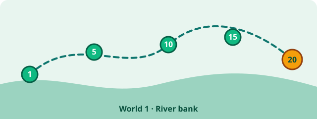

# Game design

**Core loop:** pick a stone → place it on the stack → the stack settles → score by height and balance.
A level ends when the stack falls or the timer runs out.

## Worlds

| World | Levels | New mechanic |
| --- | --- | --- |
| River bank | 1–20 | Basic stacking |
| Waterfall | 21–40 | Wet stones slide |
| Moss cave | 41–60 | Sticky moss patches |

## Scoring

- Height: 10 points per stone above the water line
- Balance bonus: ×1.5 when the stack's centre stays inside the base
- Perfect level: no undo used

> Keep sessions under three minutes. Most players open the game while waiting for something.

## Open questions

- [x] Do we show the next stone? → yes, after world 1
- [ ] Should undo cost anything?
- [ ] Music: one calm loop per world, or generative?
